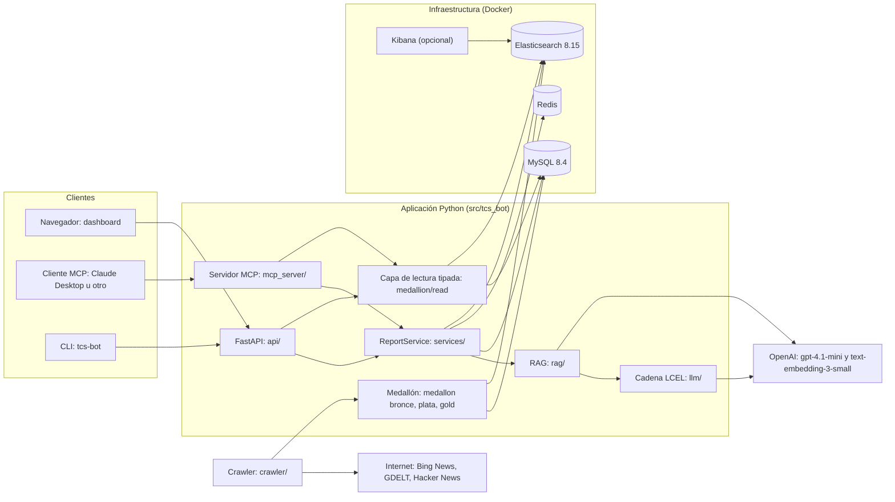
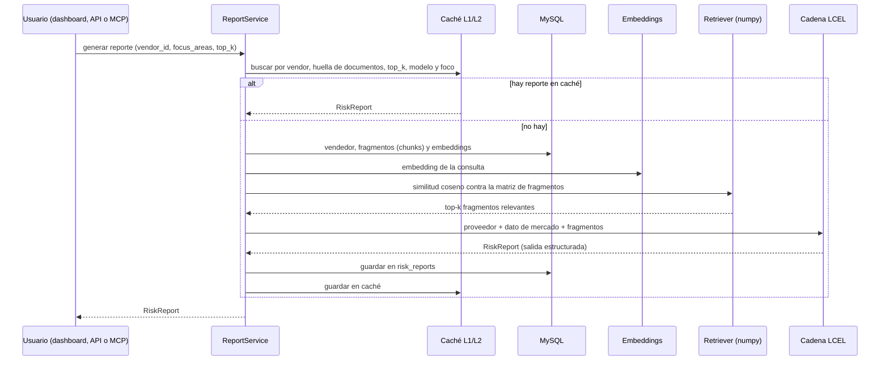
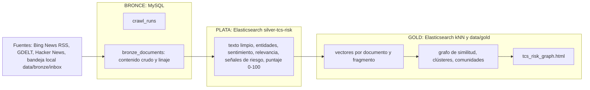

# Arquitectura de TCS Bot

Este documento explica cómo está construido el sistema, qué hace cada pieza y por qué se tomaron
las decisiones principales. Describe el estado real del repositorio (octubre-noviembre de 2026).
El detalle campo por campo de los datos está en [DATA_STRUCTURE.md](DATA_STRUCTURE.md) (en inglés)
y el historial de cambios en [BUILD_LOG.md](BUILD_LOG.md).

## 1. Qué es el sistema

El repositorio contiene **dos subsistemas** que comparten infraestructura (MySQL, Redis,
Elasticsearch) y la misma API:

| | Subsistema A: reporte de riesgo de proveedores | Subsistema B: pipeline medallón de riesgo de TCS |
|---|---|---|
| Objetivo | Generar con IA un reporte estructurado de riesgo de un proveedor del mercado de capitales | Rastrear noticias y comunidades sobre Tata Consultancy Services (TCS) y convertirlas en una vista de riesgo |
| Entrada | Informes financieros, noticias y presentaciones regulatorias (texto o PDF) | Páginas web, RSS y APIs públicas, más archivos locales |
| Salida | JSON `RiskReport`: puntaje de riesgo, banderas rojas, salud financiera y recomendaciones de cumplimiento | Documentos con puntaje de riesgo, clústeres, grafo interactivo y búsqueda semántica |
| Requisito de origen | El enunciado "AI-Based Supplier Risk Assessment Report Generator for Capital Markets" | Especificación 005 (`specs/005-tcs-risk-medallion/`) |

Todo el dato de proveedores es **sintético**. Los datos del subsistema B son noticias reales,
obtenidas respetando `robots.txt`.

## 2. Vista general

**Principios que gobiernan el diseño**

1. **Contrato antes que código.** Cada funcionalidad tiene una especificación en `specs/` con
   criterios de aceptación numerados (por ejemplo AC-003.10). Los cambios de contrato se
   actualizan en la misma confirmación (commit) que el código.
2. **Salidas estructuradas.** El modelo de lenguaje no devuelve texto libre: devuelve un objeto
   Pydantic validado. Si no cumple el esquema, la llamada falla en lugar de entregar datos malos.
3. **Determinismo.** Temperatura 0.0 y modelos fijados (`gpt-4.1-mini`, `text-embedding-3-small`).
   Un cambio de modelo o de temperatura se registra como advertencia.
4. **Degradar sin romper.** Si falta una dependencia (por ejemplo Elasticsearch), `/health` sigue
   respondiendo y las rutas devuelven errores controlados (503), no caídas.
5. **Cortesía y legalidad al rastrear.** Se respeta `robots.txt`, hay límites de ritmo y los
   bloqueos no se evaden.

## 3. Subsistema A: reporte de riesgo de proveedores

### 3.1 Flujo de un reporte

### 3.2 Piezas

| Pieza | Código | Qué hace |
|---|---|---|
| Ingesta | `ingestion/` | Extrae texto de PDF, `.txt` y `.md`; usa OCR (tesseract y poppler) para PDF escaneados; normaliza y divide en fragmentos |
| Embeddings | `rag/embeddings.py` | `text-embedding-3-small` (1536 dimensiones). Con `LLM_PROVIDER=fake` usa un embebedor local determinista para pruebas sin red |
| Recuperación | `rag/retriever.py` | Similitud coseno con **numpy** (matriz normalizada por filas, producto matricial, top-k) |
| Cadena LLM | `llm/chain.py` | `ChatPromptTemplate` seguido de `ChatOpenAI(gpt-4.1-mini, temperature=0)` y `.with_structured_output(RiskReport)` |
| Servicio | `services/report_service.py` | Orquesta ingesta, re-embebido automático al cambiar de modelo, recuperación, generación, caché y persistencia |
| Caché | `cache/` | L1 en proceso (TTL y LRU) y L2 en Redis. La clave incluye vendedor, huella de documentos, foco, `top_k` y modelo, de modo que cambiar de modelo nunca sirve un reporte viejo |
| Persistencia | `db/` | MySQL con pool de conexiones y transacciones (`transaction()`); tablas `vendors`, `vendor_documents`, `document_chunks`, `risk_reports`, `audit_log`, `schema_migrations` |
| Búsqueda | `search/elastic.py` | Índices `vendor-chunks` (fragmentos con `dense_vector`) y `market-quotes` (cotizaciones) |

### 3.3 El reporte (`RiskReport`)

Definido en `schemas/report.py`. Es el contrato entre el modelo de lenguaje, la API, el MCP y el
dashboard:

- `overall_risk_score` (0 a 100) y `risk_level` (`low`, `medium`, `high`, `critical`; el nivel se
  deriva del puntaje: 25, 50 y 75 son los cortes).
- `red_flags[]`: categoría, severidad, descripción y evidencia citada.
- `financial_health`: resumen, liquidez, rentabilidad, apalancamiento y señal de mercado.
- `compliance_recommendations[]`: prioridad, recomendación y referencia regulatoria (DORA,
  FINRA, SEC, etc.).
- `risk_narrative`, `sources[]`, `data_gaps[]`, `generated_at` y `model`.

### 3.4 Interfaces

**API HTTP (FastAPI)**: `GET /health`, `GET /vendors`, `GET /vendors/{id}`,
`POST /vendors/{id}/documents` (JSON), `POST /vendors/{id}/documents/upload` (PDF o texto),
`POST /reports`, `GET /reports/{vendor_id}/latest`. Errores con un formato único
`{"error": {"code", "message", "details"}}` (`api/errors.py`).

**Herramienta MCP** (`mcp_server/server.py`, servidor `vendor-risk`): `generate_vendor_risk_report`
y `list_vendors`, más las herramientas del subsistema B. Funciona por stdio
(`uv run tcs-bot-mcp`) o `streamable-http`. El esquema de salida de la herramienta es el esquema
de `RiskReport`.

**Dashboard** (`GET /`, archivo `api/static/dashboard.html`): una página autocontenida con dos
pestañas.

- *Vendor reports*: lista de proveedores con su puntaje, resumen de la cartera y, por proveedor,
  las cuatro secciones: puntaje general, banderas rojas, salud financiera y recomendaciones de
  cumplimiento. Genera reportes bajo demanda.
- *MCP console*: elige una herramienta MCP, arma el formulario desde su esquema de entrada,
  la ejecuta y muestra la respuesta junto con la solicitud `tools/call` cruda. El navegador no
  puede hablar MCP por stdio, así que `api/mcp_console.py` expone `GET /mcp-console/tools` y
  `POST /mcp-console/call`, que abren una sesión de cliente MCP en memoria contra el servidor real
  (protocolo completo: `tools/list` y `tools/call`).

Todo texto que viene del modelo se inserta en el DOM como texto (`textContent`), nunca como HTML.

## 4. Subsistema B: pipeline medallón de TCS

El patrón medallón separa los datos por nivel de refinamiento. Cada capa se puede volver a
calcular a partir de la anterior.

La llave que une las tres capas es el mismo número: `id` en bronce = `doc_id` en plata y gold.

### 4.1 Bronce: datos crudos e inmutables

- **Dónde:** MySQL, base `vendor_risk`, tablas `bronze_documents` y `crawl_runs`
  (esquema en `src/tcs_bot/db/schema_002_medallion.sql`).
- **Qué guarda:** el documento tal como se obtuvo (`raw_content`), su URL y URL canónica, la
  fuente, el tipo de fuente, la consulta que lo encontró, la URL padre, la profundidad (≤ 2), el
  estado HTTP, las fechas y dos huellas SHA-256 (de la URL y del contenido).
- **Deduplicación:** `url_sha256` es único. Los enlaces de redirección de Bing llevan
  identificadores distintos en cada ejecución, así que `canonical_url` conserva solo el parámetro
  `url=`; de lo contrario la misma noticia se guardaría una vez por ejecución.
- **Rastreador** (`crawler/src/gfinance_crawler/news/`): recorrido en anchura (`bfs.py`) con
  profundidad máxima 2 y tope de 500 documentos por corrida. `fetch.py` respeta `robots.txt`, aplica
  espaciado por servidor y trata HTTP 429 como bloqueo (no reintenta). Las fuentes están en
  `sources.py`.
- **Bandeja local:** archivos `.html`, `.txt`, `.json` o `.pdf` en `data/bronze/inbox/` entran como
  bronce sin tocar internet.

### 4.2 Plata: limpieza y señales de riesgo

Código en `medallion/silver/`.

1. **Extracción** (`extract.py`): texto limpio a partir de HTML, JSON o PDF.
2. **Entidades y sentimiento** (`entities.py`, `sentiment.py`).
3. **Relevancia** (`classify.py`): decide si el documento trata realmente de TCS. Es relevante si
   su puntaje de relevancia supera el umbral (0.35) y tiene al menos 30 palabras o el título nombra
   a TCS. Esto evita falsos positivos como "Taking Children Seriously".
4. **Señales de riesgo** (`classify.py`): 65 reglas con expresiones regulares en 10 categorías
   (ética, cumplimiento, legal, privacidad y ciberseguridad, laboral y RR. HH., financiero,
   operativo, reputacional, ESG y geopolítica o inmigración). El puntaje de riesgo pondera las
   señales por su cercanía a las frases que mencionan a TCS, limita la evidencia lejana y amortigua
   textos largos.
5. **Almacén** (`store.py`): índice `silver-tcs-risk` en Elasticsearch.
6. **LLM opcional** (`llm.py`): con una clave real, una cadena `gpt-4.1-mini` con salida
   estructurada puede complementar la extracción. Sin clave se usan solo las reglas.

### 4.3 Gold: vectores, grafo y clústeres

Código en `medallion/gold/`.

- **Selección y deduplicación** (`dedupe.py`): solo pasan los documentos relevantes; la misma
  noticia vista por varias fuentes se fusiona (10 duplicados fusionados en la corrida actual).
- **Embeddings** (`embedder.py`): `text-embedding-3-small` cuando hay clave y
  `LLM_PROVIDER=openai`; si no, un embebedor local TF-IDF más SVD ("LSA", 256 dimensiones).
  El nombre del índice incluye el modelo, así que los espacios vectoriales nunca se mezclan.
- **Almacén vectorial** (`vector_store.py`): dos índices de Elasticsearch,
  `gold-tcs-risk-docs--<modelo>` y `gold-tcs-risk-chunks--<modelo>`, con un campo `dense_vector`
  (coseno, HNSW). La búsqueda usa la API `knn` con filtros por categoría, fuente y fecha.
- **Análisis** (`analytics.py`): grafo de los k vecinos más cercanos (k=5, coseno mínimo 0.35),
  clústeres con KMeans (k elegido por coeficiente de silueta), comunidades con Louvain y etiquetas
  con c-TF-IDF.
- **Artefactos** (`data/gold/`): `graph.json`, `graph.graphml`, `summary.json`, `lsa.pkl` y
  `tcs_risk_graph.html`, una visualización interactiva autocontenida y sin llamadas de red (`viz.py`).

### 4.4 Capa de lectura tipada

`medallion/read/` (`get_tcs_data()`) une bronce, plata y gold por `id` y expone modelos Pydantic:
listar y filtrar documentos, detalle, documentos similares, búsqueda semántica, desglose por
categoría, resumen de riesgo y clústeres. El contenido crudo y el texto completo son opcionales.

La API (`api/tcs_routes.py`) publica esto como `/tcs/risks/documents`, `/documents/{id}`,
`/documents/{id}/similar`, `/categories`, `/overview`, `/clusters`, `/clusters/{id}`, `/search`,
`/summary` y `/graph`. El MCP ofrece `search_tcs_risks`, `tcs_risk_summary`, `list_tcs_risks`,
`get_tcs_risk_document`, `similar_tcs_risks` y `tcs_risk_clusters`.

## 5. Despliegue

`docker-compose.yml` define seis servicios:

| Servicio | Perfil | Función |
|---|---|---|
| `mysql` | siempre | MySQL 8.4: datos de proveedores, reportes y capa bronce |
| `redis` | siempre | Caché L2 |
| `elasticsearch` | siempre | Elasticsearch 8.15.3 sin seguridad (solo desarrollo local), puerto 9200 |
| `api` | `app` | FastAPI en el puerto 8000: aplica migraciones, siembra datos, indexa y sirve |
| `medallion` | `app` | Ejecución periódica del pipeline (con cron) |
| `crawler` | `app` | Rastreador de Google Finance (cotizaciones) con cron |

Kibana 8.15.3 se ejecuta aparte con `docker run` en la misma red (puerto 5601); ver el README.
Las imágenes de Docker son de varias etapas y las de ejecución usan un usuario sin privilegios.

Comandos principales (`uv run tcs-bot ...`): `up`, `down`, `status`, `migrate`, `seed`, `index`,
`crawl`, `api`, `mcp` y `medallion run|bronze|silver|gold|schedule`.

## 6. Configuración y secretos

Toda la configuración sale de `get_settings()` (`config.py`) y de variables de entorno (archivo
`.env`, ignorado por git). Las más relevantes: `OPENAI_API_KEY`, `LLM_PROVIDER` (`openai` o
`fake`), `OPENAI_CHAT_MODEL`, `OPENAI_EMBEDDING_MODEL`, `MYSQL_*`, `ELASTIC_URL`, `GOLD_INDEX_PREFIX`,
`GOLD_GRAPH_K`, `GOLD_GRAPH_MIN_COSINE` y `MEDALLION_RELEVANCE_THRESHOLD`. Nunca se versionan claves
ni datos reales de clientes.

## 7. Calidad y proceso

- **Pruebas:** unitarias sin red (≈ 500, con proveedor falso y dobles de Elasticsearch), de
  integración contra servicios reales, extremo a extremo (`-m e2e`) contra la API y una prueba de
  humo con OpenAI real (`-m openai`).
- **Estilo:** `ruff check` y `ruff format` limpios.
- **CI:** `.github/workflows/ci.yml` (lint, pruebas unitarias con cobertura, integración y e2e con
  MySQL, Redis y Elasticsearch, y construcción de imágenes). Requiere que la facturación de GitHub
  esté activa.
- **Desarrollo guiado por especificaciones:** `specs/` (constitución y una carpeta por
  funcionalidad), contexto compartido en `AGENTS.md` y agentes y habilidades de Claude en `.claude/`.

## 8. Decisiones clave y sus motivos

| Decisión | Motivo |
|---|---|
| Similitud coseno con numpy para los reportes de proveedores | Lo pide el requisito; el volumen por proveedor es pequeño y evita depender del motor de búsqueda para la recuperación |
| Vectores del medallón en Elasticsearch (no Qdrant) | Un solo motor para texto, filtros y kNN; Elasticsearch ya estaba en la infraestructura; simplifica CI y despliegue |
| Índices de gold con el modelo en el nombre | Permite tener vectores LSA y OpenAI a la vez sin mezclar espacios de distinta dimensión |
| Embebedor local (LSA) y proveedor `fake` | Todo el sistema se prueba sin red ni costo; el camino real se verifica aparte con `-m openai` |
| Bronce inmutable y plata y gold recalculables | Se pueden cambiar las reglas o el modelo sin volver a rastrear |
| Respeto de `robots.txt` y no reintentar 429 | Legalidad y cortesía; las fuentes bloqueadas se informan como `blocked` |
| Bridge MCP en memoria para el dashboard | El navegador no habla stdio; así la consola muestra exactamente lo que recibiría un cliente MCP |
| Dashboard como un único archivo HTML | Sin paso de compilación, sin dependencias externas, fácil de servir desde la API |

## 9. Limitaciones conocidas

- **Volumen del rastreo:** unos 60 documentos por corrida, no 500. Google News y Reddit prohíben a
  los rastreadores genéricos en `robots.txt`, GDELT responde 429 y Bing a veces no devuelve
  resultados. Llegar a 500 exigiría más fuentes legítimas, no evadir bloqueos.
- **Reglas de riesgo:** no hay reglas para historias de vigilancia de empleados o casos de
  conversión (puntaje 0); algunos títulos traen caracteres dañados (por ejemplo `Facebook?s`).
- **Búsqueda sin clave de OpenAI:** el embebedor LSA devuelve vector cero para consultas con
  palabras que no están en el corpus, y la búsqueda no devuelve nada.
- **CI de GitHub:** nunca se ejecutó porque la cuenta tiene la facturación bloqueada.
- **Imágenes:** solo se construyó la variante amd64; la suma de verificación de `supercronic`
  para arm64 no está fijada.
- **Elasticsearch sin seguridad:** adecuado para una máquina local, no para producción.
