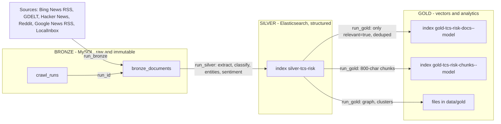

# TCS risk medallion: data dictionary

What every layer of the TCS risk medallion pipeline (spec 005) stores, field by field, and how to
query it. Snapshot taken **2026-11-06** against the local stack. Sources of truth, in order: the
live Elasticsearch mappings and MySQL DDL, then the code
(`src/tcs_bot/medallion/`, `src/tcs_bot/db/schema_002_medallion.sql`), then
`specs/005-tcs-risk-medallion/`.

All example rows below are marked **SYNTHETIC EXAMPLE**: invented text on `example.com` domains.
No crawled article text, title or URL is reproduced in this file; real data is used only for counts.

Contents: [1 Overview](#1-overview) | [2 Bronze](#2-bronze-mysql) | [3 Silver](#3-silver-elasticsearch)
| [4 Gold](#4-gold-elasticsearch-vectors--files) | [5 Risk model](#5-risk-model-categories-severity-score-relevance-dedupe)
| [6 Queries](#6-handy-queries) | [Read layer and API](#read-layer-and-api)

---

## 1. Overview



### Join key

One document keeps **one integer id through all layers**:

```
bronze_documents.id  ==  silver-tcs-risk._id / doc_id  ==  gold docs doc_id  ==  gold chunks doc_id
```

Gold chunk `_id` is `"<doc_id>:<chunk_index>"`, gold doc `_id` is `"<doc_id>"`. In
`data/gold/graph.json` a node's `id` is the same `doc_id`.

### Who writes what

| Layer | Store | Writer (code path) | CLI | Idempotency key | Re-run behaviour |
|---|---|---|---|---|---|
| Bronze | MySQL `crawl_runs`, `bronze_documents` | `medallion/bronze.py` (`run_bronze`, `BronzeRepository.save_batch`); crawler in `crawler/src/gfinance_crawler/news/` | `uv run tcs-bot medallion bronze [--max-docs N --max-depth D]` | `url_sha256 = sha256(canonical_url or url)`, UNIQUE | Existing URLs are skipped (counted as `duplicates`); rows are never updated except the `silver_processed_at` watermark |
| Silver | ES `silver-tcs-risk` | `medallion/silver/pipeline.py` (`run_silver`), `silver/store.py` (`SilverStore.upsert`) | `uv run tcs-bot medallion silver` | ES `_id = doc_id` (full replace); watermark `bronze_documents.silver_processed_at` | Only rows with `silver_processed_at IS NULL` are processed; the watermark is set only after the ES upsert succeeded |
| Gold | ES `gold-tcs-risk-docs--<model>`, `gold-tcs-risk-chunks--<model>`; files in `data/gold/` | `medallion/gold/pipeline.py` (`run_gold`), `gold/vector_store.py` (`GoldVectorStore`) | `uv run tcs-bot medallion gold` | ES `_id = doc_id` (docs), `doc_id:chunk_index` (chunks) | **Full rebuild**: the indices of the active model are recreated and every file in `data/gold/` is rewritten |
| All | | `medallion/pipeline.py` (`run_layers`) | `uv run tcs-bot medallion run` (bronze, silver, gold); `uv run tcs-bot medallion schedule --cron "0 */6 * * *"` | | |

Run the CLI with `uv run ...` (or `python -m uv run ...` where `uv` is not on PATH).

### Count snapshot (2026-11-06)

| Store | Object | Count |
|---|---|---|
| MySQL | `crawl_runs` | 3 |
| MySQL | `bronze_documents` | 61 rows (ids 1..77, gaps are normal), 0 with `silver_processed_at IS NULL` |
| ES | `silver-tcs-risk` | 61 documents (32 `relevant=true`, 29 `relevant=false`) |
| ES | `gold-tcs-risk-docs--lsa_256` | 22 documents (32 relevant minus 10 near-duplicates merged) |
| ES | `gold-tcs-risk-chunks--lsa_256` | 113 chunks |
| Files | `data/gold/graph.json` | 22 nodes, 45 links, 7 KMeans clusters, 4 Louvain communities |

`GET silver-tcs-risk/_count` returns 61, but `_cat/indices` shows `docs.count = 253`: Lucene also
counts the nested `risk_signals` sub-documents (61 + 192 signals = 253). Use `_count` for the number
of documents.

---

## 2. Bronze (MySQL)

Raw documents exactly as fetched. Database `vendor_risk` (setting `MYSQL_DATABASE`), InnoDB,
`utf8mb4_unicode_ci`. DDL: `src/tcs_bot/db/schema_002_medallion.sql` (migration 002, applied by
`uv run tcs-bot migrate`). Pydantic contract: `BronzeDocument`, `CrawlStats` in
`medallion/models.py`. All DATETIME values are **naive UTC**.

### Table `bronze_documents`

| Column | Type | Null | Meaning | Example (SYNTHETIC) |
|---|---|---|---|---|
| `id` | BIGINT AUTO_INCREMENT, PK | no | Document id; the join key for silver and gold | `1042` |
| `run_id` | BIGINT, FK to `crawl_runs.id` (ON DELETE SET NULL) | yes | Crawl run that stored the row | `7` |
| `url` | TEXT | no | URL as fetched | `https://news.example.com/2026/11/acme-audit?utm=x` |
| `url_sha256` | CHAR(64), UNIQUE `uq_bronze_documents_url_sha` | no | `sha256(canonical_url or url)`; idempotency key | `9f86d0...0a08` |
| `canonical_url` | TEXT | no | Normalised URL used for same-URL dedupe | `https://news.example.com/2026/11/acme-audit` |
| `parent_url` | TEXT | yes | Page on which the link was found (depth >= 1); NULL at depth 0 | `https://news.example.com/search?q=acme` |
| `depth` | TINYINT, default 0 | no | BFS depth, 0..2: 0 search/listing item, 1 linked article or thread, 2 TCS-relevant outbound link of a depth-1 page | `1` |
| `source` | VARCHAR(32) | no | Source adapter: `google_news`, `bing_news`, `gdelt`, `hackernews`, `reddit`, `local_inbox`, `web` (followed link) | `bing_news` |
| `source_type` | ENUM('news','community','corporate','other'), default `news` | no | Kind of source | `news` |
| `query` | VARCHAR(255), default `''` | no | Risk query that discovered the doc (empty for LocalInbox) | `TCS lawsuit` |
| `title` | TEXT | yes | Title from the source (silver falls back to the extracted title, then the URL) | `Acme vendor faces audit` |
| `raw_content` | MEDIUMTEXT | no | Body as fetched (HTML, JSON, RSS/XML or text); truncated to 3,000,000 characters | `<html>...</html>` |
| `content_type` | VARCHAR(64), default `text/html` | no | MIME type; silver picks the extractor from it (`application/json`, `application/rss+xml`, `text/html`, ...) | `text/html` |
| `http_status` | SMALLINT, default 200 | no | HTTP status of the fetch | `200` |
| `published_at` | DATETIME | yes | Publication time if the source gave one | `2026-11-02 08:15:00` |
| `fetched_at` | DATETIME | no | When the crawler fetched it | `2026-11-06 12:36:38` |
| `content_sha256` | CHAR(64) | no | sha256 of the stored `raw_content` (change detection) | `ab12...ef` |
| `silver_processed_at` | DATETIME | yes | Silver watermark: NULL means "not yet in silver"; set (UTC) after a successful silver upsert | `2026-11-06 13:13:07` |

Indexes: `ix_bronze_documents_silver (silver_processed_at, id)`, `ix_bronze_documents_run (run_id)`,
`ix_bronze_documents_source (source)`.

### Table `crawl_runs`

| Column | Type | Null | Meaning |
|---|---|---|---|
| `id` | BIGINT AUTO_INCREMENT, PK | no | Run id (referenced by `bronze_documents.run_id`) |
| `started_at` | DATETIME, default now | no | Start (UTC) |
| `finished_at` | DATETIME | yes | End (UTC); NULL while running or if the process died |
| `params` | JSON | yes | `{"queries": [...22 risk queries], "sources": [...], "max_docs": 500, "max_depth": 2, "per_query_limit": null}` |
| `stats` | JSON | yes | Counters, see below |

`stats` keys seen on a finished run: `run_id`, `discovered`, `fetched`, `yielded`, `stored` (NEW
rows), `duplicates` (already in bronze), `skipped_irrelevant`, `blocked` (robots.txt, 4xx, proxy,
HTTP 429), `failed`, `links_skipped`, `by_depth` (`{"0": n, "1": n, "2": n}`), `by_source`, `errors`
(list of strings). `CrawlStats` in `models.py` declares only the first group of these; the crawler
adds `yielded`, `links_skipped` and `errors`.

### SYNTHETIC EXAMPLE (bronze row, `raw_content` shortened)

```json
{
  "id": 1042, "run_id": 7,
  "url": "https://news.example.com/2026/11/acme-audit?utm=x",
  "url_sha256": "<64 hex chars>",
  "canonical_url": "https://news.example.com/2026/11/acme-audit",
  "parent_url": null, "depth": 0,
  "source": "bing_news", "source_type": "news", "query": "TCS lawsuit",
  "title": "Acme Outsourcing faces audit over a delivery dispute",
  "raw_content": "<html><body><p>Invented text about a fictional vendor ...</p></body></html>",
  "content_type": "text/html", "http_status": 200,
  "published_at": "2026-11-02 08:15:00", "fetched_at": "2026-11-06 12:36:38",
  "content_sha256": "<64 hex chars>", "silver_processed_at": null
}
```

---

## 3. Silver (Elasticsearch)

Index `silver-tcs-risk` (setting `SILVER_INDEX`), 1 shard, 0 replicas, `dynamic: false` (unknown
fields would stay in `_source` but are not indexed). `_id = doc_id` (the bronze id as a string).
Pydantic contract: `SilverRecord` (`medallion/models.py`); mapping: `SILVER_MAPPING` in
`medallion/silver/store.py`. The live mapping matches the code exactly (checked 2026-11-06).

### Top-level fields

| Field | ES type | Null | Meaning | Example (SYNTHETIC) |
|---|---|---|---|---|
| `doc_id` | long | no | Bronze `id` | `1042` |
| `url` | keyword | no | Source URL | `https://news.example.com/2026/11/acme-audit` |
| `domain` | keyword | no | Host without leading `www.` | `news.example.com` |
| `source` | keyword | no | Same values as bronze `source` | `bing_news` |
| `source_type` | keyword | no | `news`, `community`, `corporate`, `other` | `news` |
| `depth` | integer | no | Crawl depth 0..2 | `0` |
| `parent_url` | keyword | yes | Page the link was found on | `null` |
| `query` | keyword | no | Discovering risk query (may be `""`) | `TCS lawsuit` |
| `title` | text + sub-field `title.keyword` (ignore_above 512) | no | Bronze title, else extracted title, else the URL | `Acme Outsourcing faces audit` |
| `clean_text` | text (analyzer `english`) | no | Main text after extraction (trafilatura, bs4 fallback, or JSON/RSS parsers) and normalisation | `Invented body text ...` |
| `summary` | text (analyzer `english`) | no (may be `""`) | First 2-3 informative sentences (>= 8 words, no boilerplate, not the title), max 600 chars; the LLM path writes its own | `Acme was audited ...` |
| `language` | keyword | no | `en`, `hi` (Devanagari) or `und` (heuristic) | `en` |
| `word_count` | integer | no | Words in `clean_text` | `412` |
| `published_at` | date | yes | Publication time (ISO 8601 UTC in `_source`) | `2026-11-02T08:15:00Z` |
| `processed_at` | date | no | When silver built the record | `2026-11-06T13:13:07Z` |
| `entities` | object | no | Extracted entities, each list deduped, max 20 | see below |
| `entities.organizations` | keyword (ignore_above 256), array | no | Companies (known list + legal-suffix pattern) | `["Acme Outsourcing Ltd"]` |
| `entities.people` | keyword array | no | Known execs + role/honorific patterns | `["Jane Roe"]` |
| `entities.regulators` | keyword array | no | Canonical regulator names (SEC, SEBI, ...) | `["SEBI"]` |
| `entities.places` | keyword array | no | Places gazetteer + aliases | `["Mumbai"]` |
| `entities.money` | keyword array | no | Amounts with currency (INR, USD, EUR, GBP, crore, lakh, million, billion) | `["$5 million"]` |
| `tcs_relevance` | float | no | 0..1: how much the document is *about* Tata Consultancy Services (see section 5) | `0.78` |
| `relevant` | boolean | no | Gate for gold. `tcs_relevance >= threshold` (default 0.35) AND (`word_count >= 30` OR the title names TCS) | `true` |
| `risk_signals` | **nested** | no (may be empty) | One entry per distinct (category, keyword) | see below |
| `risk_signals.category` | keyword | no | One of the 10 categories | `legal_litigation` |
| `risk_signals.severity` | keyword | no | `low`, `medium`, `high`, `critical` | `high` |
| `risk_signals.keyword` | keyword | no | Rule or concept that fired | `lawsuit` |
| `risk_signals.evidence` | text | no | Sentence supporting the signal, max 300 chars | `Acme was sued over ...` |
| `risk_categories` | keyword array | no | Distinct categories of `risk_signals`, in taxonomy order (denormalised for cheap filtering) | `["legal_litigation"]` |
| `sentiment` | float | no | -1..1, finance/risk lexicon with negation window | `-0.41` |
| `risk_score` | float | no | 0..100 overall document risk (see section 5); scaled down when the doc is below the relevance threshold | `47.5` |
| `extractor` | keyword | no | `rules-v1` (deterministic) or the OpenAI model id when the LLM path enriched the record | `rules-v1` |

Every field in this table exists in both the live mapping and `SilverRecord`. `risk_signals` items
have exactly four fields (`category`, `severity`, `keyword`, `evidence`).

### Semantics worth knowing

- **`relevant`**: `false` rows are kept for audit but excluded from gold. The title rule: a document
  shorter than 30 words (headline-only Hacker News hits, RSS stubs) still counts as relevant when
  its *title itself* names TCS (company name, the acronym `TCS`, `tcs.com`, the CEO's name), because
  the headline is then the story. A body-only mention in a short item does not count. Live check: all
  32 relevant docs have `tcs_relevance >= 0.4546`, all 29 irrelevant ones are `<= 0.2832`, and 4
  relevant docs have fewer than 30 words (title rule).
- **`risk_score` of irrelevant docs** is multiplied by `tcs_relevance / threshold`, so a generic
  article about layoffs that barely mentions TCS cannot look risky.
- **`risk_categories`** is derived from `risk_signals`; filter on it for plain terms queries, use the
  nested query when category and severity must hold for the *same* signal.
- **`extractor`**: the LLM is only called for documents with >= 30 words and rules relevance >=
  threshold / 2, and only when `LLM_PROVIDER` is not `fake`; any LLM error falls back to the rules
  record. Currently every silver doc is `rules-v1`.

### SYNTHETIC EXAMPLE (silver `_source`, `clean_text` shortened)

```json
{
  "doc_id": 1042,
  "url": "https://news.example.com/2026/11/acme-audit",
  "domain": "news.example.com",
  "source": "bing_news", "source_type": "news", "depth": 0, "parent_url": null,
  "query": "TCS lawsuit",
  "title": "Acme Outsourcing faces audit over a delivery dispute",
  "clean_text": "Invented text. Acme Outsourcing was sued by a fictional client after a missed go-live ...",
  "summary": "Acme Outsourcing was sued by a fictional client after a missed go-live.",
  "language": "en", "word_count": 412,
  "published_at": "2026-11-02T08:15:00Z",
  "entities": {"organizations": ["Acme Outsourcing Ltd"], "people": ["Jane Roe"],
               "regulators": [], "places": ["Mumbai"], "money": ["$5 million"]},
  "tcs_relevance": 0.78, "relevant": true,
  "risk_signals": [
    {"category": "legal_litigation", "severity": "high", "keyword": "lawsuit",
     "evidence": "Acme Outsourcing was sued by a fictional client after a missed go-live."},
    {"category": "operational_delivery", "severity": "high", "keyword": "project failure",
     "evidence": "The project failed to meet its go-live date."}
  ],
  "risk_categories": ["legal_litigation", "operational_delivery"],
  "sentiment": -0.41, "risk_score": 47.5,
  "extractor": "rules-v1", "processed_at": "2026-11-06T13:13:07Z"
}
```

---

## 4. Gold (Elasticsearch vectors + files)

Gold is rebuilt from scratch on every run from the **relevant** silver documents after near-duplicate
merging (section 5). It has two parts: two vector indices and a set of files in `data/gold/`
(setting `GOLD_DIR`).

### 4.1 Vector indices

Names: `<GOLD_INDEX_PREFIX>-docs--<model_slug>` and `<GOLD_INDEX_PREFIX>-chunks--<model_slug>`, prefix
default `gold-tcs-risk`. The slug is the embedding model id lower-cased with non-alphanumerics
replaced by `_`, so vector spaces of different models never share an index:

| Embedder (selected by `get_gold_embedder`) | Model id | Slug | Dims |
|---|---|---|---|
| Offline TF-IDF + SVD ("LSA"), used when `LLM_PROVIDER=fake` / no OpenAI key; setting `LSA_DIM` (default 256) | `lsa-256` | `lsa_256` | 256 (zero-padded, L2-normalised) |
| OpenAI (when configured) | `text-embedding-3-small` | `text_embedding_3_small` | 1536 |

Live indices (2026-11-06): `gold-tcs-risk-docs--lsa_256` (22 docs) and
`gold-tcs-risk-chunks--lsa_256` (113 chunks). Both: 1 shard, 0 replicas, `dynamic: false`,
and **identical mappings**:

| Field | ES type | Null | Meaning | Example (SYNTHETIC) |
|---|---|---|---|---|
| `doc_id` | long | no | Bronze/silver id (join key) | `1042` |
| `chunk_index` | integer | yes | 0-based chunk number; **null in the docs index** | `2` (chunks), `null` (docs) |
| `title` | text + `title.keyword` (ignore_above 512) | no | Silver title | `Acme Outsourcing faces audit` |
| `url` | keyword (ignore_above 2048) | no | Silver url | `https://news.example.com/2026/11/acme-audit` |
| `domain` | keyword | no | Silver domain | `news.example.com` |
| `source` | keyword | no | Silver source | `bing_news` |
| `source_type` | keyword | no | Silver source_type | `news` |
| `published_at` | date | yes | Silver published_at | `2026-11-02T08:15:00+00:00` |
| `risk_categories` | keyword array | no | Silver risk_categories | `["legal_litigation"]` |
| `risk_score` | float | no | Silver risk_score | `47.5` |
| `sentiment` | float | no | Silver sentiment | `-0.41` |
| `cluster` | integer | no | KMeans cluster id of the document (0 = largest); chunks inherit it from their document | `0` |
| `community` | integer | no | Louvain community id of the document (0 = largest); chunks inherit it | `1` |
| `text` | text | no | Display text, max 1000 chars: docs index = silver `summary` (or `clean_text` when the summary is empty); chunks index = the chunk text | `Acme Outsourcing was sued ...` |
| `embedding` | **dense_vector**, `dims` 256 (live), `index: true`, `similarity: cosine`, `index_options: {type: hnsw, m: 16, ef_construction: 100}` | no | The vector. Excluded from search results (`source_excludes`) | 256 floats |

- `_id`: docs index `"<doc_id>"` (e.g. `"1042"`), chunks index `"<doc_id>:<chunk_index>"` (e.g.
  `"1042:2"`). Re-running gold overwrites instead of duplicating.
- ES refuses zero-magnitude vectors under cosine; gold does not send them (the document is counted
  as failed and the run reports `vector_store: partial: N documents failed`), and a zero query
  vector (out-of-vocabulary query) returns no hits.
- ES kNN `_score` for cosine is `(1 + cos) / 2`; the project maps it back (`cosine = 2 * score - 1`)
  in `GoldHit.score`. If you query ES directly, convert yourself.
- What is embedded: **documents** use `embedding_text(r)` = title repeated 3 times + summary + first
  150 words of the body (a whole thread drifts off-topic, so the lead is a better topic signal).
  **Chunks** cover the full text: `title + "\n" + chunk`, chunks of 800 chars with 120 overlap
  (`RAG_CHUNK_SIZE`, `RAG_CHUNK_OVERLAP`), at most 50 per document.
- `GoldHit` (`models.py`, returned by the search API): `doc_id`, `chunk_index`, `score` (cosine),
  `title`, `url`, `text`, `risk_categories`, `risk_score`, `cluster`.

### SYNTHETIC EXAMPLE (gold chunk `_source`, vector omitted)

```json
{
  "_id": "1042:2",
  "doc_id": 1042, "chunk_index": 2,
  "title": "Acme Outsourcing faces audit over a delivery dispute",
  "url": "https://news.example.com/2026/11/acme-audit", "domain": "news.example.com",
  "source": "bing_news", "source_type": "news",
  "published_at": "2026-11-02T08:15:00+00:00",
  "risk_categories": ["legal_litigation", "operational_delivery"],
  "risk_score": 47.5, "sentiment": -0.41, "cluster": 0, "community": 1,
  "text": "...the project failed to meet its go-live date and the client filed a claim...",
  "embedding": "[256 floats, L2-normalised]"
}
```

### 4.2 Files in `data/gold/`

All written by `run_gold` (`medallion/gold/pipeline.py`); JSON files are UTF-8, written atomically.
Snapshot generated `2026-11-06T13:13:09+00:00`.

| File | Content |
|---|---|
| `graph.json` | Full graph document: keys `meta`, `nodes`, `links`, `clusters`, `communities`, `stats` |
| `summary.json` | `graph.json` without `nodes` and `links`: keys `meta`, `clusters`, `communities`, `stats` |
| `graph.graphml` | The same graph for Gephi/yEd/networkx (undirected) |
| `tcs_risk_graph.html` | Self-contained interactive visualisation (data embedded, no network needed): open it in a browser |
| `lsa.pkl` | The fitted LSA embedder (only when the model is `lsa-*`; deleted when OpenAI embeddings are used). Needed at query time to embed search queries into the same space. Python pickle: load only your own file |

#### `graph.json` -> `meta`

| Key | Type | Meaning |
|---|---|---|
| `generated_at` | string (ISO UTC) | Build time |
| `embedding_model` | string | `lsa-256` or `text-embedding-3-small`; the query side reads this to pick the embedder |
| `n_docs` | int | Nodes (relevant docs after dedupe); 22 |
| `n_duplicates_merged` | int | Near-duplicates folded into other nodes; 10 |
| `n_chunks` | int | Chunks in the chunks index; 113 |
| `n_edges` | int | `len(links)`; 45 |
| `n_clusters`, `n_communities` | int | KMeans clusters (7) and Louvain communities (4) |
| `graph_k`, `graph_min_cosine` | int, float | Effective k-NN degree (capped at `round(sqrt(n))`, min 2) and cosine threshold (0.35) |
| `graph_k_configured` | int | `GOLD_GRAPH_K` (a cap), 5 |
| `n_isolated` | int | Nodes with no edge |
| `kmeans` | object | `k`, `k_requested`, `silhouette`, `scores` (`{k: silhouette}`), `k_target`, `n_merged` |
| `data_source` | string | Provenance note; gets a "SYNTHETIC TEST DATA" suffix when any record looks synthetic |
| `synthetic` | bool | True if any record's extractor/source/domain contains "synthetic" |
| `vector_indices` | array of 2 strings | `[docs index, chunks index]` actually written |
| `vector_backend` | string | `elasticsearch` |
| `vector_store` | string | `ok`, `partial: N documents failed`, `unavailable: ...` or `skipped: no documents` |

#### `graph.json` -> `nodes[]` (one per gold document)

| Key | Type | Meaning |
|---|---|---|
| `id` | int | `doc_id` |
| `title`, `url`, `domain`, `source`, `source_type` | string | From silver |
| `published_at` | string or null | ISO 8601 |
| `risk_score` | float | Silver risk_score (2 decimals) |
| `sentiment` | float | Silver sentiment (3 decimals) |
| `relevance` | float | Silver `tcs_relevance` (renamed) |
| `risk_categories` | string[] | Silver categories |
| `dominant_category` | string or null | Category with the most severity weight (low 1, medium 2, high 3, critical 4) across the signals |
| `cluster` | int | KMeans cluster id (0 = largest) |
| `community` | int | Louvain community id (0 = largest) |
| `x`, `y` | float | 2-D PCA projection of the document vector, scaled to [-1, 1] (used for the layout) |
| `degree`, `betweenness`, `eigenvector` | float | Centrality in the similarity graph (betweenness uses cosine distance; eigenvector falls back to degree if it does not converge) |
| `summary` | string | `summary` (or `clean_text`) cut to 400 chars |
| `merged_doc_ids` | int[] | Ids of near-duplicate silver docs folded into this node (empty if none) |
| `also_seen_in` | int | `len(merged_doc_ids)`: how many other crawls of the same story exist |
| `merged_sources` | object[] | `{doc_id, source, domain, url}` for each merged duplicate |
| `signals` | object[] | First 6 silver risk signals: `{category, severity, keyword, evidence (<= 300 chars)}` |
| `entities` | object | Only `organizations`, `regulators`, `places`, each cut to 6 (no people/money) |
| `neighbors` | `[[doc_id, cosine], ...]` | The 8 most similar other documents, cosine desc (not limited by the edge threshold) |

#### `graph.json` -> `links[]` (the similarity edges; note the key is `links`, not `edges`)

`{ "source": <doc_id>, "target": <doc_id>, "cosine": 0.8754, "mutual": true }`.
An edge exists when `cosine >= graph_min_cosine` and one document is in the other's top-k.
`mutual` is true when each is in the other's top-k. The graph is undirected.

#### `graph.json` -> `clusters[]` and `communities[]`

Same shape (`ClusterSummary`): `cluster` (the id, also used for communities), `size`, `label`
(for example "Legal: term1 / term2" when one category holds at least half the weight, otherwise the
top terms), `top_terms` (list), `dominant_categories` (`{category: count}`), `mean_risk_score`,
`mean_intra_cosine`, `representative_doc_ids` (up to 3). `clusters` come from KMeans on L2-normalised
vectors (k chosen by cosine silhouette, smallest k within tolerance of the best, clusters under 2
docs folded into the nearest); `communities` come from Louvain on the cosine-weighted graph (seed
42, communities under 2 docs merged into their strongest neighbour).

#### `graph.json` -> `stats` (also in `summary.json`)

| Key | Meaning |
|---|---|
| `category_counts` | `{category: n_docs}` for all 10 categories (zeros included) |
| `cosine_histogram` | `{edges: [...], counts: [...]}` of pairwise cosines (20 bins) |
| `category_cooccurrence` | `{categories: [...10], matrix: 10x10 counts}` |
| `sources` | `{by_source, by_source_type, by_domain (top 15)}` |
| `timeline` | `[{month: "YYYY-MM", count, mean_risk, by_category}]` by `published_at` |
| `top_risky` | Top 15 docs by risk: `{doc_id, title, url, domain, risk_score, risk_categories, published_at}` |
| `top_cross_source_pairs` | Most similar pairs from different domain/source: `{a, b, a_title, b_title, a_domain, b_domain, cosine}` |
| `mean_risk_score` | Mean `risk_score` over nodes |

#### `graph.graphml`

Undirected, node ids are `str(doc_id)`. GraphML only holds scalars, so list/dict attributes are
JSON strings and nulls are empty strings. Node attributes: `title, url, domain, source, source_type,
published_at, risk_score, sentiment, relevance, risk_categories (JSON string), dominant_category,
cluster, community, x, y, degree, betweenness, eigenvector, summary, merged_doc_ids (JSON string),
also_seen_in, merged_sources (JSON string), signals (JSON string), entities (JSON string)`. There is
no `neighbors` attribute. Edge attributes: `cosine`, `weight` (cosine clamped above 0, used by
Louvain), `mutual`.

#### `tcs_risk_graph.html`

Generated by `medallion/gold/viz.py` (`render_html`) from `graph.json`; the data is embedded in the
page, so it opens offline. It offers a force layout and a PCA layout (the `x`/`y` fields), colouring
by `cluster`, `community` or `dominant_category`, and shows the `meta` (including "Vector store").
It is derived output: never edit it, rebuild with
`uv run tcs-bot medallion gold`.

### SYNTHETIC EXAMPLE (one `graph.json` node and one link)

```json
{
  "id": 1042, "title": "Acme Outsourcing faces audit over a delivery dispute",
  "url": "https://news.example.com/2026/11/acme-audit", "domain": "news.example.com",
  "source": "bing_news", "source_type": "news", "published_at": "2026-11-02T08:15:00+00:00",
  "risk_score": 47.5, "sentiment": -0.41, "relevance": 0.78,
  "risk_categories": ["legal_litigation", "operational_delivery"],
  "dominant_category": "legal_litigation",
  "cluster": 0, "community": 1, "x": -0.42, "y": 0.18,
  "degree": 0.24, "betweenness": 0.11, "eigenvector": 0.31,
  "summary": "Acme Outsourcing was sued by a fictional client ...",
  "merged_doc_ids": [1050], "also_seen_in": 1,
  "merged_sources": [{"doc_id": 1050, "source": "hackernews", "domain": "forum.example.com",
                      "url": "https://forum.example.com/item/1"}],
  "signals": [{"category": "legal_litigation", "severity": "high", "keyword": "lawsuit",
               "evidence": "Acme Outsourcing was sued by a fictional client."}],
  "entities": {"organizations": ["Acme Outsourcing Ltd"], "regulators": [], "places": ["Mumbai"]},
  "neighbors": [[1043, 0.8754], [1047, 0.8609]]
}
```
```json
{ "source": 1042, "target": 1043, "cosine": 0.8754, "mutual": true }
```

---

## 5. Risk model: categories, severity, score, relevance, dedupe

Implemented in `medallion/silver/classify.py` (rules path `rules-v1`), `medallion/silver/pipeline.py`
and `medallion/gold/dedupe.py`.

### 5.1 The 10 risk categories (`RiskCategory`)

| Value | Meaning | Rules |
|---|---|---|
| `ethics` | Bribery, corruption, fraud, money laundering, insider trading, misconduct, whistleblowers, falsification, conflict of interest | 9 |
| `compliance_regulatory` | Regulator probes, penalties/fines, show-cause notices, violations, antitrust, audit qualification, investigations, tax disputes | 8 |
| `legal_litigation` | Lawsuits, settlements, verdicts/damages, trade secrets, infringement, criminal charges, court proceedings | 7 |
| `data_privacy_cyber` | Data breach, ransomware, cyberattack, leaks, hacking/malware, privacy violations, vulnerabilities | 7 |
| `labor_hr` | Layoffs, discrimination/harassment, forced resignation, unpaid wages, toxic culture, bench policy, attrition/unions | 7 |
| `financial` | Profit warning, margin/revenue decline, share price fall, downgrade, impairment, going concern | 7 |
| `operational_delivery` | Outages, project failure/delay, contract termination, client loss, missed SLAs | 5 |
| `reputational` | Scandal, boycott, backlash, controversy, criticism | 5 |
| `esg` | Emissions, greenwashing, human rights, forced labour, ESG downgrade | 5 |
| `geopolitical_immigration` | Visa fraud, H-1B/L-1 issues, sanctions, tariffs/export controls, immigration | 5 |

65 regex rules in total (`TAXONOMY`). Current data has signals in 8 of the 10 categories; `financial`
and `esg` have no signal yet (that says nothing about the classifier, only about this crawl).

### 5.2 Severity levels

`low` (5 points), `medium` (12), `high` (25), `critical` (40). Each rule has a base severity
(32 high, 24 medium, 9 critical rules; no rule is `low`). **Negation** lowers the severity by one
level when the sentence contains words like "denied", "no evidence of", "dismissed the case",
"cleared of", "baseless", "rumours", which is the only way `low` appears (4 low signals in the
current index).

### 5.3 Risk score (0-100), in plain words

1. The title counts as the first sentence; the text is split into sentences. Every sentence is
   matched against the 65 rules.
2. For each distinct `(category, keyword)` the strongest occurrence is kept as one `RiskSignal`
   (evidence = that sentence, cut at 300 chars).
3. Each signal gets points = severity points x **proximity weight** x **title boost**. The
   proximity weight depends on how many sentences it is from the nearest sentence that names TCS:
   same sentence 1.0, 1 away 0.8, 2 away 0.6, further 0.25. The title boost is 1.5 when the signal
   also fires in the title. This keeps generic words ("court", "layoffs") in far-away text from
   scoring like a real TCS event.
4. Signals with weight above 0.25 ("near") are combined with the "far" ones, whose combined
   contribution is capped at 18 points.
5. Combination has diminishing returns: `score = 100 * (1 - prod(1 - p/100))` over the points `p`
   (each capped at 95), so many signals approach but never exceed 100.
6. Long texts are damped: for more than 300 words the score is divided by
   `1 + 0.12 * log2(words / 300)`. The result is rounded to 1 decimal.
7. If the document is **below the relevance threshold**, the score is scaled by
   `tcs_relevance / threshold` (`attribute_risk`).

Worked mini example (SYNTHETIC): one `high` signal in a sentence naming TCS = 25 points; a second
`critical` signal two sentences away = 40 x 0.6 = 24; combined `100 * (1 - 0.75 * 0.76)` = 43.0, no
length damping for a short text.

### 5.4 TCS relevance and the `relevant` flag

`tcs_relevance` (0..1) = `0.45 * mention saturation + 0.25 * density + 0.30 * title names TCS`, where
mentions are `TCS`, "Tata Consultancy", `tcs.com`, the CEO's surname (weak mentions such as the
chairman's name count half). "TCS (Tata Consultancy Services)" counts once. Corrections:

- TCS only in the body (title does not name it): x0.6, recovering towards x1.0 as TCS grows from 1
  to 3 mentions per 100 words; a "Tata ..." headline without TCS: a further x0.6.
- Indian tax "Tax Collected at Source" / LRS / remittance context (also abbreviated TCS): x0.1 to
  x0.6, so tax articles are not mistaken for the company.
- Other Tata group companies (Tata Motors, Tata Steel, Air India, ...): x0.15 when TCS itself is not
  named, x0.5 when they are mentioned more than twice as often as TCS.

`relevant = tcs_relevance >= MEDALLION_RELEVANCE_THRESHOLD (default 0.35)` **and** (`word_count >= 30`
**or the title names TCS**). Only `relevant=true` documents reach gold.

### 5.5 Dedupe in gold (`gold/dedupe.py`)

The same story is often crawled twice (a search snippet at depth 0 and the full page at depth 1, or
a Hacker News hit and its thread). Gold merges them at build time; **silver is never modified**.
Two documents are duplicates when any of these holds (TF-IDF cosine over `title + clean_text`):

- the *normalised* titles are equal (lower-cased, accents and punctuation removed, trailing
  "- Outlet" removed) and the text cosine is at least 0.1;
- the text cosine is at least 0.9 whatever the titles say;
- the titles share at least 3 words, their word-set Jaccard is at least 0.7, and the text cosine is
  at least 0.6.

Pairs that only match on title or title overlap and were published more than 7 days apart are
treated as different posts (recurring threads). Duplicate groups are the connected components of the
relation. The richest document is kept: longest text, then deeper depth (full page), then higher
risk score, then lowest id. The others are listed on the kept node (`merged_doc_ids`,
`also_seen_in`, `merged_sources`) and are absent from the gold indices.

---

## 6. Handy queries

Run the examples against `http://localhost:9200` (setting `ELASTIC_URL`) and database `vendor_risk`.
They are read-only.

### 6.1 MySQL

```sql
-- layer sizes and backlog
SELECT COUNT(*) AS bronze_rows,
       SUM(silver_processed_at IS NULL) AS waiting_for_silver
FROM bronze_documents;

-- rows per source / type / depth (never select raw_content in bulk: it is MEDIUMTEXT)
SELECT source, source_type, depth, COUNT(*) AS n
FROM bronze_documents GROUP BY source, source_type, depth ORDER BY n DESC;

-- one document without its body
SELECT id, run_id, url, canonical_url, depth, source, query, content_type, http_status,
       published_at, fetched_at, LENGTH(raw_content) AS raw_bytes, silver_processed_at
FROM bronze_documents WHERE id = 1042;

-- lineage: which runs stored what
SELECT r.id, r.started_at, r.finished_at,
       JSON_EXTRACT(r.stats, '$.stored')    AS stored,
       JSON_EXTRACT(r.stats, '$.duplicates') AS duplicates,
       JSON_EXTRACT(r.stats, '$.blocked')   AS blocked,
       COUNT(b.id) AS rows_now
FROM crawl_runs r LEFT JOIN bronze_documents b ON b.run_id = r.id
GROUP BY r.id ORDER BY r.id;

-- children found on a parent page
SELECT id, url FROM bronze_documents WHERE parent_url = 'https://news.example.com/search?q=acme';
```

### 6.2 Elasticsearch query DSL

Kibana Dev Tools syntax with `//` comments (for a shell use
`curl -H 'content-type: application/json' localhost:9200/<index>/_search -d '<body>'` and strip the
comments).

```jsonc
// counts
GET silver-tcs-risk/_count
GET silver-tcs-risk/_count   { "query": { "term": { "relevant": true } } }

// silver: relevant docs of one category, riskiest first (no vectors, no body)
GET silver-tcs-risk/_search
{ "size": 10, "_source": { "excludes": ["clean_text"] },
  "query": { "bool": { "filter": [
      { "term": { "relevant": true } },
      { "term": { "risk_categories": "legal_litigation" } },
      { "range": { "risk_score": { "gte": 40 } } } ] } },
  "sort": [ { "risk_score": "desc" } ] }

// silver: category AND severity on the SAME signal (needs the nested query)
GET silver-tcs-risk/_search
{ "size": 10, "_source": ["doc_id", "title", "risk_score"],
  "query": { "bool": { "filter": [
    { "term": { "relevant": true } },
    { "nested": { "path": "risk_signals", "inner_hits": { "_source": ["risk_signals.keyword", "risk_signals.evidence"] },
        "query": { "bool": { "filter": [
          { "term": { "risk_signals.category": "data_privacy_cyber" } },
          { "terms": { "risk_signals.severity": ["high", "critical"] } } ] } } } } ] } } }

// silver: full text in the title/summary/body plus a filter
GET silver-tcs-risk/_search
{ "size": 5, "_source": ["doc_id", "title"],
  "query": { "bool": { "must": [ { "multi_match": { "query": "layoffs", "fields": ["title^3", "summary", "clean_text"] } } ],
                       "filter": [ { "term": { "relevant": true } } ] } } }

// silver: aggregations (category x severity, relevant split, sources)
GET silver-tcs-risk/_search
{ "size": 0, "aggs": {
    "relevant": { "terms": { "field": "relevant" } },
    "by_source": { "terms": { "field": "source" } },
    "signals": { "nested": { "path": "risk_signals" }, "aggs": {
        "cat": { "terms": { "field": "risk_signals.category" }, "aggs": {
            "sev": { "terms": { "field": "risk_signals.severity" } } } } } } } }

// gold: one document and its chunks (ids are deterministic)
GET gold-tcs-risk-docs--lsa_256/_doc/1042?_source_excludes=embedding
GET gold-tcs-risk-chunks--lsa_256/_search
{ "size": 50, "_source": { "excludes": ["embedding"] },
  "query": { "term": { "doc_id": 1042 } }, "sort": [ { "chunk_index": "asc" } ] }

// gold: documents of a cluster / community
GET gold-tcs-risk-docs--lsa_256/_search
{ "size": 50, "_source": { "excludes": ["embedding"] }, "query": { "term": { "cluster": 0 } } }

// gold: kNN with a filter. query_vector must come from the SAME embedder (see 6.3);
// num_candidates >= k; filter is applied inside the kNN search. Score = (1 + cosine) / 2.
GET gold-tcs-risk-chunks--lsa_256/_search
{ "size": 5, "_source": { "excludes": ["embedding"] },
  "knn": { "field": "embedding", "query_vector": [ /* 256 floats */ ], "k": 5, "num_candidates": 100,
           "filter": { "bool": { "filter": [
               { "terms": { "risk_categories": ["labor_hr", "legal_litigation"] } },
               { "range": { "risk_score": { "gte": 30 } } } ] } } } }
```

### 6.3 Python (project settings and clients, no secrets in code)

Run as `python -m uv run python script.py` from the repo root. Connection details come from
`get_settings()` / `.env`.

```python
# MySQL (always through the project's transaction helper)
from tcs_bot.db.mysql import transaction

with transaction() as cur:  # cur returns dict rows
    cur.execute(
        "SELECT source, COUNT(*) AS n FROM bronze_documents GROUP BY source ORDER BY n DESC"
    )
    print(cur.fetchall())

# or through the repository
from tcs_bot.medallion.bronze import BronzeRepository

repo = BronzeRepository()
print(repo.count(), repo.count("silver"))  # all rows, rows not yet in silver
```

```python
# Silver: Elasticsearch client from settings, typed records through SilverStore
from tcs_bot.search.elastic import get_es
from tcs_bot.config import get_settings
from tcs_bot.medallion.silver.store import SilverStore

es = get_es()
res = es.search(
    index=get_settings().silver_index,
    query={
        "bool": {
            "filter": [{"term": {"relevant": True}}, {"term": {"risk_categories": "labor_hr"}}]
        }
    },
    sort=[{"risk_score": "desc"}],
    source_excludes=["clean_text"],
    size=10,
)
for h in res["hits"]["hits"]:
    print(h["_id"], h["_source"]["risk_score"], h["_source"]["title"])

store = SilverStore()
rec = store.get(1042)  # SilverRecord | None
relevant = list(store.iter_relevant())  # what gold consumes
print(store.count(), store.count(relevant_only=True))
```

```python
# Gold: semantic search with the embedder gold was built with (LSA from lsa.pkl, or OpenAI)
from tcs_bot.medallion.gold.search import search_risks

hits = search_risks("data breach at a client", k=5, categories=["data_privacy_cyber"], min_risk=20)
for h in hits:  # GoldHit: score is the cosine similarity
    print(round(h.score, 3), h.doc_id, h.chunk_index, h.risk_score, h.title)

# lower level: your own vector + filters (cluster, community, sources, source_types)
from tcs_bot.medallion.gold.embedder import model_slug
from tcs_bot.medallion.gold.search import get_vector_store, query_embedder

emb = query_embedder()
vs = get_vector_store().with_model(model_slug(emb))
# Offline LSA only knows words from the gold corpus: an out-of-vocabulary query embeds to a
# zero vector and returns []. Use terms that occur in the data (OpenAI embeddings have no such limit).
vec = emb.embed(["layoffs discrimination probe"])[0]
print(vs.search(vec, k=5, level="docs", cluster=0))
print(vs.count("docs"), vs.count("chunks"), vs.stats())
```

```python
# Gold files
import json
from pathlib import Path

g = json.loads(Path("data/gold/graph.json").read_text(encoding="utf-8"))
print(g["meta"]["n_docs"], g["meta"]["embedding_model"])
by_id = {n["id"]: n for n in g["nodes"]}  # id == doc_id == bronze id
top = sorted(g["nodes"], key=lambda n: -n["risk_score"])[:5]
edges = [(e["source"], e["target"], e["cosine"]) for e in g["links"]]

import networkx as nx

G = nx.read_graphml("data/gold/graph.graphml")  # node ids are strings; lists are JSON strings
```

---

## Read layer and API

Code in `src/tcs_bot/medallion/read/` reads the three layers through typed Pydantic models, so
consumers do not write SQL or Elasticsearch queries. Spec: AC-005.12.

### Python facade

```python
from tcs_bot.medallion.read import DocumentFilters, Page, get_tcs_data

data = get_tcs_data()
page = data.list_documents(
    DocumentFilters(category=["legal_litigation"], min_severity="high"),
    Page(limit=20, sort="risk_score"),
)
detail = data.get_document(page.items[0].doc_id)  # bronze lineage + silver + gold node
similar = data.similar_documents(detail.silver.doc_id, k=5)
```

| Method | Returns |
|---|---|
| `list_documents(filters, page)` | `DocumentPage` (items + total) |
| `get_document(doc_id, include_raw=False, include_text=False)` | `DocumentDetail` = `silver` + `bronze` + `gold` |
| `similar_documents(doc_id, k=10)` | `SimilarDocuments` (kNN by the stored gold vector) |
| `search(query, k, filters)` | `list[GoldHit]` |
| `category_breakdown(relevant_only=True)` | `CategoryBreakdown` |
| `risk_overview(relevant_only=True, top_n=5)` | `RiskOverview` (by category, severity, source, month, top docs) |
| `list_clusters(kind)` / `get_cluster(id, kind)` | `ClusterSummary` list / `ClusterDetail` |

- The join key is the same everywhere: bronze `id` = silver `doc_id` = gold `doc_id`.
- `DocumentFilters`: `category[]`, `min_severity`, `min_risk_score`, `source[]`, `source_type[]`,
  `relevant` (default `True`; `None` = all), `published_from`, `published_to`, `cluster`,
  `community`, `q`.
- `Page`: `limit` 1 to 100 (default 20), `offset`, `sort` (`risk_score`, `published_at`,
  `tcs_relevance`), `order`; `offset + limit` must be at most 10000.
- Raw bronze content and full clean text are opt-in (`include_raw`, `include_text`) and are never
  logged. The MCP tools never return raw bodies.
- A document folded into another by gold dedupe has `gold.in_gold = False` and
  `merged_into = <kept id>`; `similar_documents` then uses the kept document's vector.
- `cluster` / `community` filters use the member ids in `data/gold/graph.json`, so deduped documents
  are not members.

### HTTP API (`/tcs/risks`)

| Route | Parameters | Response |
|---|---|---|
| `GET /search` | `q`, `k` | `list[GoldHit]` |
| `GET /summary`, `GET /graph`, `GET /graph.html` | none | gold summary, graph JSON, interactive HTML |
| `GET /documents` | filters above (`category`, `source`, `source_type` repeatable), `relevant=true\|false\|all`, `sort`, `order`, `limit`, `offset` | `DocumentPage` |
| `GET /documents/{doc_id}` | `include_text`, `include_raw` | `DocumentDetail` |
| `GET /documents/{doc_id}/similar` | `k` 1 to 50 | `SimilarDocuments` |
| `GET /categories` | `relevant_only` | `CategoryBreakdown` |
| `GET /overview` | `relevant_only`, `top_n` 1 to 20 | `RiskOverview` |
| `GET /clusters` | `kind=cluster\|community` | `list[ClusterSummary]` |
| `GET /clusters/{cluster_id}` | `kind` | `ClusterDetail` |

Errors use the JSON envelope `{"error": {"code", "message", "details"}}`:

| Status | Codes |
|---|---|
| 404 | `gold_not_built`, `silver_not_built`, `document_not_found`, `document_not_in_gold`, `cluster_not_found` |
| 422 | `validation_error` |
| 503 | `silver_unavailable`, `vector_store_unavailable`, `bronze_unavailable` |

### MCP tools

- `list_tcs_risks(category, min_severity, min_risk_score, source, source_type, query, published_from,
  published_to, cluster, community, sort, order, limit=10, offset, include_irrelevant=False)`
- `get_tcs_risk_document(doc_id, include_text=False)`
- `similar_tcs_risks(doc_id, k=5)`
- `tcs_risk_clusters(cluster_id=None, kind="cluster")`
- `search_tcs_risks(query, k, category)` and `tcs_risk_summary` (earlier tools, unchanged)

### Known limits

- `by_severity` in `/overview` counts risk signals, not documents.
- `n_signals` on cluster members is capped at 6 (gold stores 6 signals per node).
- Search filters apply category, risk, source, source type, cluster and community only. Dates, `q`
  and `min_severity` are ignored by `search`.
- The offline LSA embedder maps a query with no known words to a zero vector, so `/search` returns
  an empty list for such queries. OpenAI embeddings do not have this limit.
